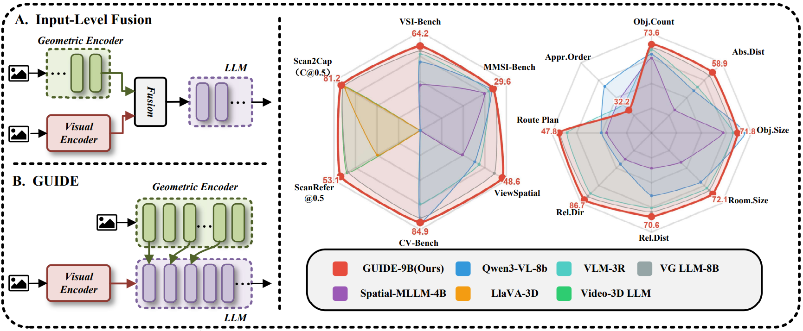
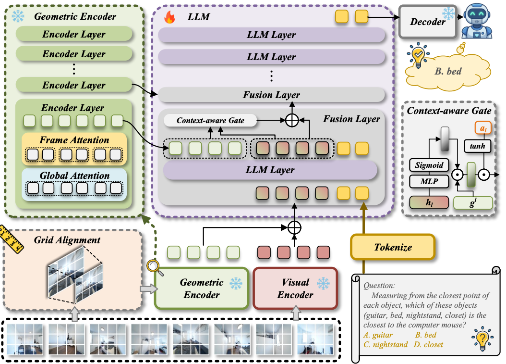

# Let Geometry GUIDE

Official repository for the paper [Let Geometry GUIDE: Layer-wise Unrolling of Geometric Priors in Multimodal LLMs](https://arxiv.org/abs/2604.05695).

<p align="center">
    <br>
</p>

## Introduction

`Let Geometry GUIDE` studies how to inject geometric priors into multimodal large language models in a progressive, layer-wise manner. Based on the GUIDE framework proposed in the paper, this repository contains:

- Qwen3-VL based training and fine-tuning code in `qwen-vl-finetune/`
- evaluation code in `lmms-eval/`
- project-level environment notes and dependency records

For the paper details, please refer to the arXiv page: [arXiv:2604.05695](https://arxiv.org/abs/2604.05695).

## Architecture
<p align="center">
    <br>
    <figcaption align="center">The architecture of our GUIDE.</figcaption>
</p>


## Repository Structure

```text
.
├── qwen-vl-finetune/   # Qwen3-VL training and fine-tuning
├── lmms-eval/          # Evaluation framework
├── requirements.txt    # Environment snapshot used in this project
└── README.md
```

## Environment Setup

This project is organized into two stages:

1. Install the Qwen3-VL training environment in `qwen-vl-finetune/`
2. Install `lmms-eval` for evaluation

It is recommended to complete them in this order.

### 1. Install Qwen3-VL

Please first follow the instructions in `qwen-vl-finetune/README.md`.

The training code in this repository is built on top of the Qwen3-VL fine-tuning framework. A minimal installation flow is:

```bash
cd qwen-vl-finetune
bash install_requirements.sh
```

The current training environment mainly depends on:

- `torch==2.6.0`
- `torchvision==0.21.0`
- `transformers==4.57.0.dev0` or newer
- `deepspeed==0.17.1`
- `flash-attn==2.7.4.post1`
- `triton==3.2.0`
- `accelerate==1.7.0`
- `torchcodec==0.2`
- `peft==0.17.1`

If you already have a custom environment, make sure the dependency versions are compatible with `qwen-vl-finetune/README.md` and `qwen-vl-finetune/install_requirements.sh`.

### 2. Install `lmms-eval` for evaluation

After the Qwen3-VL environment is ready, install the evaluation framework in `lmms-eval/`.

The upstream `lmms-eval` project recommends using `uv` for a consistent environment:

```bash
cd lmms-eval
curl -LsSf https://astral.sh/uv/install.sh | sh
uv sync
# If you additionally need Qwen video/image helpers:
uv add qwen-vl-utils
```

If you prefer isolated environments, you can also create a dedicated evaluation environment first and then install `lmms-eval`.

If you already manage `lmms-eval` with your own environment tool, make sure `qwen-vl-utils` is also installed for Qwen-based evaluation backends.

## Training

Training scripts are provided under `qwen-vl-finetune/scripts/`.

Examples:

- `qwen-vl-finetune/scripts/sft_qwen3_4b.sh`
- `qwen-vl-finetune/scripts/sft_qwen3_4b_sr.sh`
- `qwen-vl-finetune/scripts/sft_qwen3_8b.sh`
- `qwen-vl-finetune/scripts/sft_qwen3_8b_sr.sh`

Before launching training, please check:

- dataset configuration in `qwen-vl-finetune/qwenvl/data/__init__.py`
- model/data/training arguments in `qwen-vl-finetune/qwenvl/train/`
- output paths, checkpoint paths, and logging settings in the shell scripts

## Evaluation

Evaluation is conducted through `lmms-eval/`.

Evaluation scripts are provided in `qwen-vl-finetune/scripts/eval/`.

After installing `lmms-eval`, you can run:

```bash
cd lmms-eval
uv run python -m lmms_eval --help
```

Please prepare the corresponding model checkpoint path, task configuration, and dataset access credentials before running benchmarks.

## Citation

If you find this repository useful, please cite:

```bibtex
@article{wang2026letgeometryguide,
  title={Let Geometry GUIDE: Layer-wise Unrolling of Geometric Priors in Multimodal LLMs},
  author={Wang, Chongyu and Huang, Ting and Sun, Chunyu and Ning, Xinyu and Wang, Di and Tang, Hao},
  journal={arXiv preprint arXiv:2604.05695},
  year={2026}
}
```
